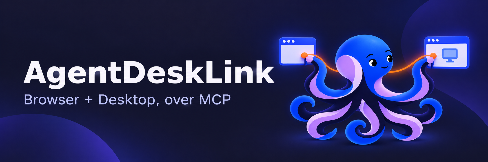

<p align="center">
  
</p>

[日本語](README.md) | **English**

# Give AI control of your browser and desktop.

**Browser and desktop alike — from the AI agent you already use.**

AgentDeskLink is an MCP server that connects AI agents to your local browser and desktop. It reads on-screen elements, performs permitted clicks and text entry, and provides images when visual context is needed.

[Get started](release-docs/INSTALL_en.md) · [What you can do](#what-you-can-do) · [Supported environments](#supported-environments) · [Release guide](release-docs/README_en.md) · [MIT License](LICENSE)

> **0.1.3 / Beta**  
> This beta is intended for a limited range of use. Before installing, review [supported environments and known limitations](release-docs/KNOWN_ISSUES_en.md).

## What you can do

| Capability | When it helps |
| --- | --- |
| **Read the screen as elements and diffs** | Get the role and value of buttons and fields, then re-read only what changed after an action |
| **Look at the parts that need it** | Capture the browser or target window to check rendering, including Canvas and charts |
| **Drive browsers and apps alike** | Run the typing, clicking, selecting and scrolling you have allowed, all over the same MCP connection |
| **Handle multiple windows separately** | Tell windows of the same app apart, and act on the one you actually observed |

Drag inside the browser, touch swipes and timestamped continuous frame capture are supported as well. Physical desktop input uses the `interactive_desktop` mode.

## Get started in VS Code

1. Download the VSIX for your OS and CPU, then install it with "Extensions: Install from VSIX".
2. Open a folder and trust the workspace.
3. Open **AgentDeskLink** in the activity bar.
4. Choose **Open Settings** and configure the allowed browser origins or desktop app and the operation permissions you need.
5. Turn on **Enable MCP for this workspace**, then start the server from the MCP management view.

**No separate Node.js installation or helper build is required.** A matching runtime ships inside the VSIX. Chrome runs in a dedicated profile, and if it is not found a dedicated Chromium is downloaded automatically on first use.

AgentDeskLink itself needs no external AI API key. AI connection and authentication happen on the MCP host side.

[See the installation steps →](release-docs/INSTALL_en.md)

## Supported environments

| Environment | What is available |
| --- | --- |
| **macOS 14 or later / Apple silicon** | Browser and desktop. Requires the OS accessibility permission, plus screen recording for image capture |
| **Windows 11 x64** | Browser and desktop. Desktop actions run in the same interactive session as the target app |
| **Linux x64** | Browser through the CLI built from source. This release has no Linux VSIX. Requires a working Chromium OS sandbox |

On macOS and Windows you can also check the state of, launch and normally close the apps you have allowed. Apps launched on Windows are placed on a dedicated Win32 desktop. Launching and closing are available when explicitly permitted in a CLI policy.

Which actions are available depends on your OS, app and display setup. See [supported environments and known limitations](release-docs/KNOWN_ISSUES_en.md) for details.

## Decide how far it can reach

- **Off by default.** MCP connection permission is separate from target access. Configure browser origins and the desktop app per workspace. Physical input and unredacted native images each default to off.
- **No configuration file is required.** The VS Code extension uses its bundled profile. When launching the CLI directly, configure targets and actions in a policy JSON.
- **Keep it apart from your everyday browser.** No human profile or sign-in state is shared.
- **Physical input uses a dedicated mode.** `interactive_desktop` uses your real mouse and keyboard, so do not run it alongside your own input.

There is no dedicated approval UI for consequential actions. Review the targets and actions you give the AI. Unknown secrets in images or text cannot be detected completely. Use Emergency Stop in the settings panel or Command Palette to stop extension-managed operations, and Resume Operations to resume. Processing already dispatched to an application cannot be undone.

## Try it from source

Clone this repository and run the following commands in its folder. Node.js 24 or later is required. The VSIX and documentation ZIP do not include the demo source.

```sh
npm ci
npx playwright install chromium
npm run build
```

In another terminal, start the local demo.

```sh
node examples/demo-server.mjs
```

Start the server from your MCP host, pointing it at the demo policy. Replace the paths with your real absolute paths. The settings file format differs by host.

```json
{
  "mcpServers": {
    "agentdesklink": {
      "command": "node",
      "args": [
        "/absolute/path/AgentDeskLink/dist/src/server.js",
        "--config",
        "/absolute/path/AgentDeskLink/config/demo.json"
      ]
    }
  }
}
```

The server connects over stdio. Using the desktop from source also requires building and configuring the OS helper.

### Example configurations

| What you want to try | Configuration file |
| --- | --- |
| Local browser demo | [demo.json](config/demo.json) |
| Browser image capture | [visual.example.json](config/visual.example.json) |
| Driving the macOS Calculator | [macos-calculator.example.json](config/macos-calculator.example.json) |
| Driving the Windows Character Map | [windows-character-map.example.json](config/windows-character-map.example.json) |

## Guides

- [Installation and first steps](release-docs/INSTALL_en.md)
- [What changed in this version](release-docs/RELEASE_NOTES_en.md)
- [Supported environments and known limitations](release-docs/KNOWN_ISSUES_en.md)
- [Update settings](release-docs/UPDATES_en.md)

## License

[MIT License](LICENSE). The third-party software we ship is covered by its own licenses.
